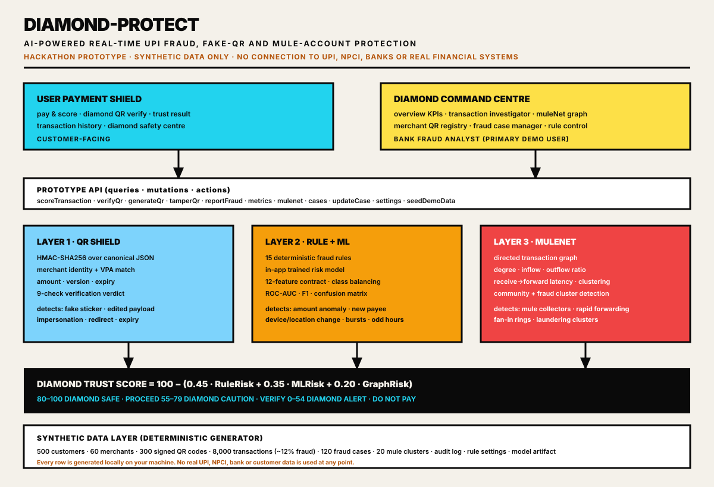

# DIAMOND-PROTECT

### AI-Powered Real-Time UPI Fraud, Fake-QR and Mule-Account Protection System

> **"Every Payment. Protected."**

A complete, open-source hackathon prototype built for an 8-hour fintech hackathon in
collaboration with **BIS (Bureau of Indian Standards)** guidance on digital payment
security.

> ### ⚠️ Prototype notice — read this first
>
> **This is a hackathon prototype built using synthetic data. It does not connect to
> UPI, NPCI, banks, payment gateways, or real financial systems.**
>
> - Every customer, merchant, transaction, QR code, fraud case and account is generated
>   locally by the deterministic synthetic generator in this repository.
> - The QR signing secret is a public demo constant, not a production key.
> - Model metrics are measured on synthetic data and are **not** real-world accuracy
>   claims.
> - It is not affiliated with, endorsed by, or certified against NPCI, RBI, BIS or any
>   bank. For a real incident always use your bank's official support channels.

---

## 1. Problem statement

UPI moved from a convenience feature to national payment infrastructure. Fraud moved
with it, and it now happens **before** the money leaves the account:

| Attack | What actually happens |
| --- | --- |
| **Fake / tampered QR stickers** | A fraudster reprints a merchant sticker with an edited payload (or their own VPA) under the same branding. The victim scans and pays the attacker. |
| **Payment redirection / merchant impersonation** | Look-alike VPAs and QR codes that mimic a trusted shop, clinic or fuel station. |
| **New-beneficiary fraud** | The payee is added seconds before the payment, often during an urgent phone call. |
| **Rapid payout and money-mule networks** | Recruited accounts collect from many victims and forward most of the money within minutes, so the funds are gone before a post-payment report is filed. |

Traditional fraud tooling is **post-payment**: it detects, reports and disputes after the
money has moved. The victim bears the loss and the mule network is one hop ahead.

## 2. Solution overview

DIAMOND-PROTECT is a **pre-authorisation protection layer**. Every payment is scored
before the user authorises it, through three independent layers:

1. **QR Shield** — cryptographically verifies the scanned merchant payload.
2. **Rule + ML risk engine** — scores the *behaviour* of this exact payment.
3. **MuleNet graph engine** — scores the *network* the money is about to enter.

The three are combined into a single **Diamond Trust Score (0–100)** with a plain-English
explanation and a concrete recommended action
(`Proceed` / `Verify Beneficiary` / `Add Extra Authentication` / `Do Not Pay`).

The product ships **two connected interfaces**:

- **User Payment Shield** — what the customer sees (pay, verify QR, trust result, history, safety centre).
- **Diamond Command Centre** — the primary demo surface for a **bank fraud analyst** (KPIs, investigator, MuleNet graph, QR registry, case manager, rule control panel).

## 3. Key features

- **Real-time pre-payment scoring** with a 0–100 Diamond Trust Score.
- **HMAC-SHA256 signed merchant QR codes** with merchant identity, amount, version and
  expiry verification, plus a one-tap **"simulate QR tampering"** attack for demos.
- **15 deterministic fraud rules** covering high value, amount anomaly, new beneficiary,
  fresh accounts, odd hours, device change, location anomaly, QR invalid / mismatch /
  expired / revoked, rapid bursts, rapid forwarding, mule linkage and unregistered
  merchants.
- **An in-app trained ML model** with class balancing, train/test split, confusion
  matrix, precision, recall, F1, ROC-AUC and per-feature contributions — and a
  **rule-based fallback** if the model artifact is missing.
- **MuleNet graph analytics**: in/out degree, total received/sent, outflow ratio, unique
  senders/receivers, receive→forward latency, clustering coefficient, community
  membership and money-mule **cluster detection**.
- **Interactive graph explorer** with cluster filters, risk filter, node risk colouring,
  amount-weighted edges and an account investigation panel.
- **Fraud case workflow** with assignment, status transitions, analyst notes, beneficiary
  blocking, false-positive marking and a full **audit trail**.
- **Live rule control panel** whose thresholds immediately change future scoring, plus a
  "scoring sandbox" that proves the change.
- **Deterministic synthetic data generator** (300+ lines of generator logic) that always
  reproduces the same demo story: 500 customers, 60 merchants, 300 signed QR codes,
  8,000 transactions (~12% fraudulent), 120 fraud cases and 20 mule clusters.
- **Demo-proof engineering**: every API call, DB read, model prediction and QR
  verification is wrapped so a failure degrades gracefully instead of breaking the demo.

## 4. Architecture



```
                              ┌───────────────────────────────┐
        Customer               │        DIAMOND-PROTECT        │      Bank fraud analyst
   ┌───────────────┐           │      pre-authorisation gate   │      ┌───────────────────┐
   │ Pay / Score   │──────────▶│                               │◀─────│ Command Centre    │
   │ QR Verify     │           │  ┌─────────┐ ┌──────┐ ┌─────┐ │      │ · Overview KPIs   │
   │ Trust Result  │◀──────────│  │ QR Shield│ │ Rule │ │Mule │ │      │ · Investigator    │
   │ History       │           │  │  HMAC   │ │ + ML │ │ Net │ │      │ · MuleNet graph   │
   │ Safety Centre │           │  └─────────┘ └──────┘ └─────┘ │      │ · QR registry     │
   └───────────────┘           │       0.45      0.35   0.20   │      │ · Case manager    │
                               │              ▼                │      │ · Rule control    │
                               │   Diamond Trust Score 0-100    │      └───────────────────┘
                               └──────────────┬────────────────┘
                                              │
                        synthetic ledger + signed QRs + audit log
```

## 5. The Diamond Trust Score

```
Diamond Trust Score = 100 − (0.45 · RuleRisk + 0.35 · MLRisk + 0.20 · GraphRisk)
```

| Score | Category | Meaning | Decision |
| --- | --- | --- | --- |
| 80–100 | **Diamond Safe** | Proceed safely | `PROCEED` |
| 65–79 | Diamond Safe / Caution boundary | Verify the beneficiary | `VERIFY_BENEFICIARY` |
| 55–64 | **Diamond Caution** | Add extra authentication | `EXTRA_AUTH` |
| 0–54 | **Diamond Alert** | Do not pay | `DO_NOT_PAY` |

Hard stops sit above the arithmetic:

- A **fake / tampered QR** can never score above 25 and is always `DO_NOT_PAY`.
- A beneficiary matching the **mule-collector profile** can never score above 40.

The weights are deliberately fixed so the score is reproducible and auditable in front of
a judge: rules print their own reasons, the model reports per-feature contributions, and
the graph layer reports the network behaviour it observed.

## 6. QR Shield

Static UPI QR codes are trivially copyable, so DIAMOND-PROTECT signs the payload instead
of trusting the sticker.

```
payload = {
  merchant_id, merchant_name, upi_id, amount,
  created_at, expires_at, nonce, version
}
signature = HMAC-SHA256(canonical_json(payload), secret)   // canonical = sorted keys
```

Verification runs nine checks and returns a structured verdict:

1. payload is valid JSON and readable
2. all 8 signed fields are present
3. amount is a valid non-negative number
4. payload version is supported
5. merchant ID exists in the registry
6. merchant credentials are not revoked
7. merchant name **and** VPA match the registry
8. **HMAC-SHA256 signature matches the canonical payload**
9. QR is inside its validity window

```json
{
  "valid": false,
  "status": "FAKE_TAMPERED",
  "riskLevel": "HIGH_RISK",
  "reason": "QR signature verification failed. Possible tampering or fake QR.",
  "merchantMatch": false,
  "recommendedAction": "Do not pay. Scan the original merchant QR or verify with the merchant."
}
```

Six real-world attacks can be simulated live from the console: impersonate the merchant
name, inflate the amount, redirect the payee VPA, backdate the expiry, forge the
signature, or strip a signed field.

## 7. MuleNet graph

A **directed transaction graph** (accounts = nodes, payments = edges, edge weight = amount,
edge timestamp = transaction time) is analysed with the same metrics NetworkX would give:

| Metric | Use |
| --- | --- |
| in-degree / out-degree | how many accounts feed it, how many it pays |
| total received / total sent | turnover through the account |
| outflow ratio | share of received money that is forwarded |
| unique senders / receivers | fan-in and fan-out breadth |
| receive → forward latency | how fast money is moved on |
| clustering coefficient | how tightly the neighbourhood is wired |
| community membership | connected component on the whole ledger |
| **fraud cluster** | connected component of the *suspicious* subgraph |

An account is flagged **`MULE_SUSPECT`** when it satisfies the documented collector
profile:

```
in_degree ≥ 6   AND   out_degree ≥ 4   AND   outflow_ratio ≥ 0.75
AND   average receive → forward latency ≤ 300 seconds
AND   connected to at least 2 other suspicious accounts
```

Fraud clusters are deliberately computed on the suspicious subgraph — a whole-ledger
component merges every customer into one blob because ordinary payments connect almost
everybody. The graph view returns nodes (risk, status, size) and edges (amount, risk) for
rendering, plus the top suspicious clusters with member count, value and the mule accounts
inside them.

## 8. Tech stack

| Layer | Requested in the brief | Shipped in this repository |
| --- | --- | --- |
| Backend | Python · FastAPI · Uvicorn · Pydantic · SQLAlchemy · SQLite | **Convex** functions (queries / mutations / actions) with a typed schema — the same request/response contracts, running in the project's own database |
| Machine learning | scikit-learn · pandas · numpy · joblib | In-app **logistic risk ensemble** trained by gradient descent on the synthetic ledger (class balancing, train/test split, confusion matrix, ROC-AUC, feature importance) + rule-based fallback |
| Graph analysis | NetworkX | **TypeScript graph engine** computing the identical metric set (degree, ratio, latency, clustering, components) |
| Dashboard | Streamlit · Plotly · Pandas · Requests | **React 19 + Vite** analyst console with Recharts and a custom SVG network canvas |
| QR security | qrcode · hashlib · hmac · json · base64 | `qrcode.react` for rendering + a dependency-free **SHA-256 / HMAC-SHA256** implementation for signing |
| Frontend | — | React 19 · TypeScript · Tailwind v4 · shadcn/ui · Framer Motion |
| Version control | Git / GitHub | Git |

Why the stack moved: this prototype must run **offline, with no Python runtime and no
paid API**, inside a browser-runtime workspace. Every algorithm in the brief is still
implemented — see [`docs/stack_mapping.md`](docs/stack_mapping.md) for the file-by-file
mapping.

## 9. Folder structure

```
.
├── src/
│   ├── convex/                      # backend: schema, API, engines, generator
│   │   ├── schema.ts                # accounts, merchants, transactions, qrCodes,
│   │   │                            # fraudCases, auditLogs, settings, modelArtifacts,
│   │   │                            # dashMetrics, graphEdges, systemMeta
│   │   ├── diamond.ts               # public API: score, QR, report, history, health
│   │   ├── commandCentre.ts         # analyst API: KPIs, mulenet, cases, settings
│   │   ├── demoSeed.ts              # batched seeding action (idempotent)
│   │   └── lib/
│   │       ├── crypto.ts            # SHA-256, HMAC-SHA256, canonical JSON, PRNG
│   │       ├── types.ts             # feature contract, rule catalogue, categories
│   │       ├── rules.ts             # 15-rule deterministic engine
│   │       ├── qrShield.ts          # sign / verify / simulate tampering
│   │       ├── diamondMl.ts         # training, metrics, explain_prediction()
│   │       ├── mulenet.ts           # graph metrics, mule detection, clusters
│   │       ├── riskEngine.ts        # composite Diamond Trust Score
│   │       ├── generator.ts         # directory + signed QR generator
│   │       ├── ledger.ts            # 8,000-transaction ledger generator
│   │       ├── aggregate.ts         # account docs + Command Centre KPIs
│   │       └── dataset.ts           # orchestrator
│   ├── components/dp/               # neobrutalist UI primitives + Shell + TrustResult
│   ├── pages/
│   │   ├── Landing.tsx              # public landing page
│   │   ├── Auth.tsx                 # sign in / OTP / guest
│   │   ├── shield/                  # PayShield, QrVerify, Result, History, SafetyCentre
│   │   └── command/                 # Overview, Investigator, MuleNetGraph,
│   │                                # MerchantRegistry, CaseManager, RuleControl
│   └── lib/dp.ts                    # formatting, tone maps, category metadata
├── docs/
│   ├── architecture.svg             # architecture diagram
│   ├── demo_script.md               # minute-by-minute live demo script
│   ├── judge_explanation.md         # judge-facing Q&A and honest limitations
│   └── stack_mapping.md             # brief stack ↔ shipped implementation
├── scripts/dataset-smoke.ts         # generator smoke test (bun scripts/dataset-smoke.ts)
└── README.md
```

## 10. Setup instructions

Requirements: **Bun** (or Node 20+ with npm) and a Convex deployment (the workspace
provisions one automatically; a free Convex account works too).

```bash
bun install            # install dependencies
bun convex dev --once  # push functions + regenerate types
bun dev                # start the app
```

## 11. How to run the backend

The backend **is** the Convex deployment in this project — no separate process to babysit:

```bash
bun convex dev --once          # deploy functions, regenerate types
bun convex run diamond:health  # smoke-test the API
```

Or call it from TypeScript exactly like the app does:

```ts
const result = await scoreTransaction({
  payerUpiId: "tanvichopra002@upidemo",
  beneficiaryUpiId: "vikramdesai009@upidemo",
  amount: 48000,
  deviceId: "DEV-NEW-777",
  location: "Delhi",
});
```

## 12. How to run the dashboard

The dashboard is the React app itself:

```bash
bun dev     # http://localhost:5173
```

Sign in on `/auth` (email OTP or "Continue as Guest"), which lands you on the analyst
Command Centre. On first load the app detects an empty database and **generates the
synthetic dataset automatically** (~12 seconds, with a progress overlay). The header has a
**Reset demo data** button that regenerates the identical deterministic dataset at any
time.

## 13. API documentation

| Function | Type | Purpose |
| --- | --- | --- |
| `diamond:scoreTransaction` | mutation | Score a payment; returns score, category, decision, component risks, reasons, signals, feature vector and network profile. `commit: false` scores without writing. |
| `diamond:generateQr` | mutation | Issue a new HMAC-signed merchant QR. |
| `diamond:verifyQr` | mutation | Verify a QR by id or raw payload; records a tamper audit entry when it fails. |
| `diamond:tamperQr` | mutation | Simulate an attack on a registry QR (6 modes). |
| `diamond:revokeQr` | mutation | Revoke a QR / merchant credential. |
| `diamond:reportFraud` | mutation | Create a fraud case from a transaction. |
| `diamond:transactions` | query | Search / filter / scan the ledger (up to 600 rows per call). |
| `diamond:transaction` | query | Full investigation payload for one transaction. |
| `diamond:qrCodes` · `diamond:merchants` | query | QR registry + merchant directory. |
| `diamond:health` | query | API, model and dataset health. |
| `diamond:demoScenarios` | query | The four preloaded demo scenarios resolved against the live ledger. |
| `commandCentre:metrics` | query | KPI set, 14-day trend, score distribution, live feed, alerts. |
| `commandCentre:mulenet` | query | Graph nodes, edges, clusters, totals. |
| `commandCentre:cases` · `commandCentre:updateCase` | query / mutation | Case queue and analyst workflow. |
| `commandCentre:setAccountStatus` | mutation | Clear / review / block an account (writes audit entries). |
| `commandCentre:registerMerchant` | mutation | Register a merchant and its account record. |
| `commandCentre:settings` · `commandCentre:updateSettings` | query / mutation | Rule control panel. |
| `demoSeed:seedDemoData` | action | Wipe + regenerate the deterministic synthetic dataset. |

Example — `scoreTransaction` on a mule beneficiary:

```json
{
  "txnId": "TXN-LIVE-934F226E",
  "diamondTrustScore": 3,
  "riskCategory": "DIAMOND_ALERT",
  "decision": "DO_NOT_PAY",
  "ruleScore": 100,
  "mlRisk": 99,
  "graphScore": 85,
  "reasons": [
    "Beneficiary matches the MuleNet money-mule behaviour profile.",
    "Beneficiary was added 10 minutes before this payment.",
    "76% of received funds were forwarded within 5 minutes.",
    "Amount is 19.2x higher than this account's normal payment pattern (₹2,500).",
    "Beneficiary account is only 26 day(s) old."
  ],
  "recommendedAction": "Do not pay. Verify the beneficiary through an official channel before retrying."
}
```

## 14. Demo scenarios

Four reliable, preloaded flows (each is resolved live from the seeded ledger and linked
from the Command Centre overview):

| # | Scenario | Setup | Expected result |
| --- | --- | --- | --- |
| 1 | **Safe payment** | Verified merchant, valid signed QR, small amount | **Diamond Safe — Proceed Safely** |
| 2 | **Fake QR attack** | QR merchant mismatch / edited payload, unknown beneficiary | **Diamond Alert — Do Not Pay** |
| 3 | **Mule account payment** | Beneficiary fans in from many accounts and forwards ~76% within ~96 seconds | **Diamond Alert — Do Not Pay**, visible as a cluster in MuleNet |
| 4 | **User fraud report** | User reports a transaction from the Safety Centre | Case appears as **NEW** in the Case Manager; analyst blocks the beneficiary; audit log records everything |

The full stage-by-stage run sheet is in [`docs/demo_script.md`](docs/demo_script.md).

## 15. Limitations (honest list)

- **Synthetic data only.** The model's ~0.94 ROC-AUC is measured on generated data with a
  known ground truth; it says nothing about production performance.
- The ML model is a logistic risk ensemble tuned in-app, not a tuned gradient-boosted or
  random-forest production model.
- Graph analytics are a single-pass snapshot computed at seed time; production would need
  incremental/streaming updates.
- Fraud clusters are connected components of the suspicious subgraph, not Louvain
  communities.
- The demo signing secret is a public constant; real deployment needs per-merchant key
  management, rotation and HSM-backed signing.
- No authentication of the scoring endpoint itself beyond the app session — the routes
  are protected, but the Convex functions do not enforce per-role authorisation.
- Not certified or validated against any regulator, scheme or bank requirement.

## 16. Future roadmap

1. **Streaming incremental graph** — update MuleNet metrics per transaction instead of at
   seed time; add temporal decay so clusters fade.
2. **Device and beneficiary reputation service** with real key rotation, per-merchant
   secrets and short-lived dynamic QR.
3. **Supervised model upgrades** — gradient boosting, calibrated probabilities, drift
   monitoring and a shadow-mode evaluation pipeline.
4. **Explainability service** — counterfactuals ("if the payee were not new, the score
   would be 91") and SHAP-style attribution.
5. **Analyst workflow hardening** — RBAC, case SLA timers, escalation policies, export to
   a regulator-friendly report.
6. **Accessibility and localisation** — Hindi and regional-language explanations, voice
   confirmation for high-risk payments.
7. **Offline-first edge scoring** with a signed model bundle so a PSP can score without a
   round trip.

## 17. BIS and RBI alignment (design reference only)

| Real-world expectation | How this prototype reflects it |
| --- | --- |
| BIS guidance on digital payment security and QR handling | Signed QR payloads, printed-sticker tamper detection, explicit "verify merchant identity" step, user-facing "do not pay" verdicts |
| RBI KYC / mule-account monitoring | Account-age features, fan-in detection, outflow-ratio analysis, beneficiary blocking with audit trail |
| NPCI UPI risk-management obligations | Pre-authorisation risk gate, per-transaction explanation, case management and reporting flow |
| Consumer protection and grievance redressal | Diamond Safety Centre, fraud report intake, audit trail, clear "official channel" guidance |
| Standardisation / interoperability | Stable JSON contracts, deterministic scoring, documented metric definitions |

**No certification, endorsement or integration is claimed.** This is a prototype built to
demonstrate the design; aligning a real deployment with these frameworks requires formal
review with the relevant authorities.

## 18. Open-source licences and credits

| Component | Licence |
| --- | --- |
| React, Vite, TypeScript, Tailwind CSS, shadcn/ui, Radix UI, Lucide, Recharts, Framer Motion, qrcode.react | MIT |
| Convex | Apache-2.0 |
| Inter, JetBrains Mono | SIL Open Font License 1.1 |

No paid APIs, no proprietary fraud-detection services and no real bank credentials are
used anywhere in this project. The SHA-256 / HMAC-SHA256 implementation in
`src/convex/lib/crypto.ts` is purpose-written for this prototype and follows RFC 2104 /
FIPS 180-4.

## 19. Team contribution section

| Role in the brief | Contribution in this repository |
| --- | --- |
| Full-stack fintech engineer | Typed data model, API surface, seeding, error handling, investigator + case workflows |
| UI/UX designer | Neobrutalist Minimalism design system, both interfaces, responsive layout, status language |
| ML engineer | Feature contract, in-app training, honest evaluation, explainable per-feature contributions |
| Hackathon mentor | Four reliable demo scenarios, deterministic generator, demo script and judge brief |

Add your team names, roles and commit list here before submitting.

---

### Closing line

> **DIAMOND-PROTECT: Every Payment. Protected.**
